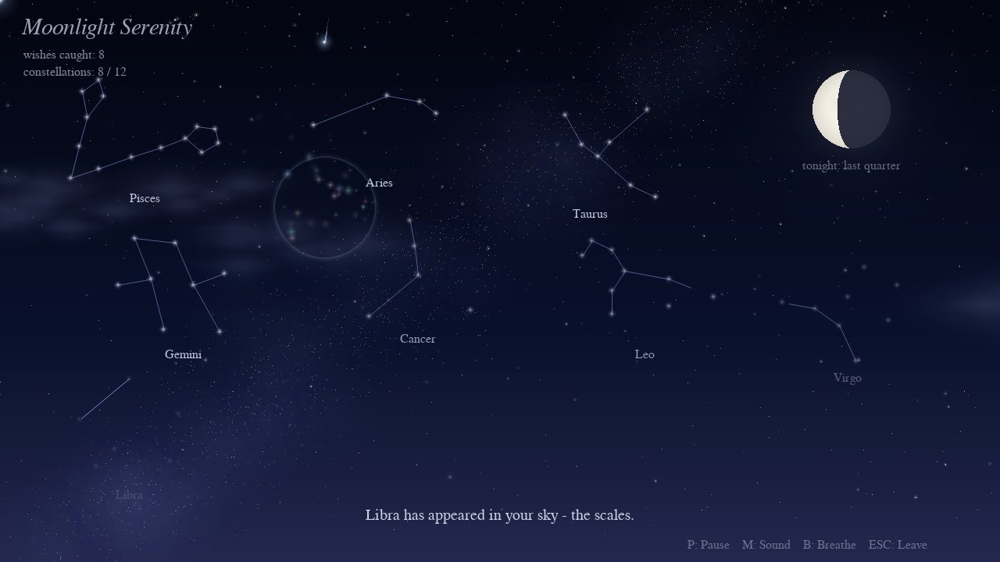
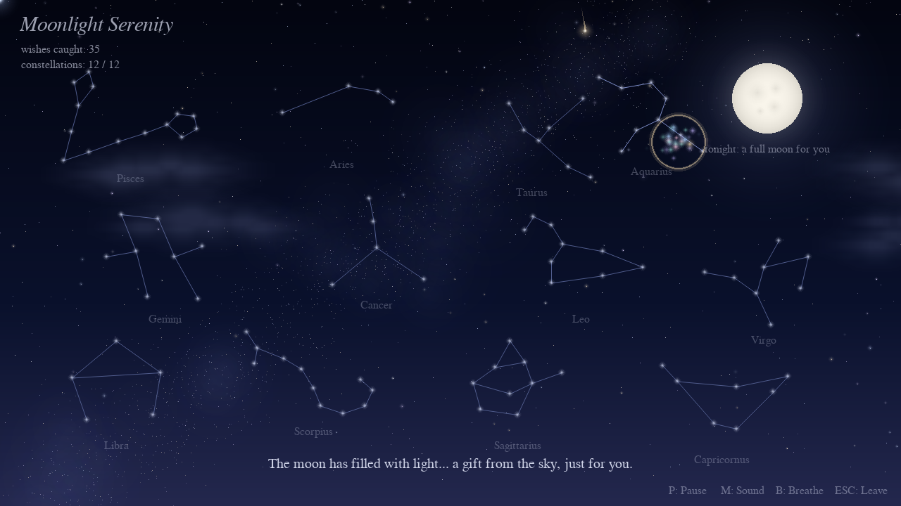
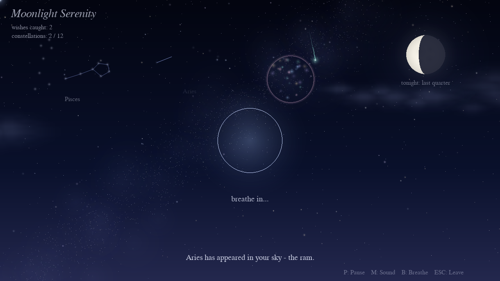
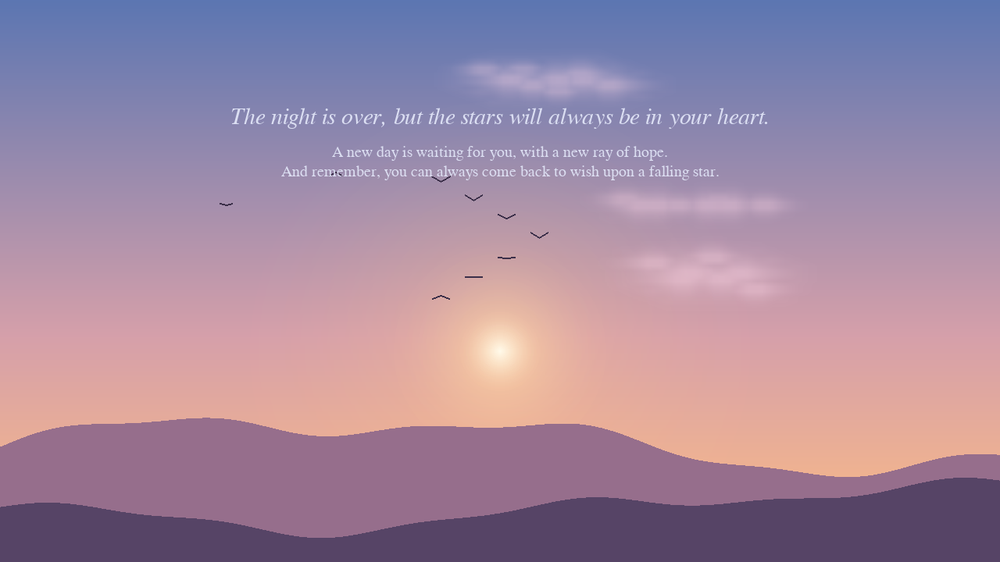

# Moonlight Serenity

> *The night is over, but the stars will always be in your heart.*

**License:** MIT (code) · music by its original artist (see [THIRD_PARTY_NOTICES](THIRD_PARTY_NOTICES.md))

A calm, no-pressure night sky for the moments when everything feels too heavy. You drift a small glowing wisp through a quiet sky and catch falling stars as wishes. Every few wishes, a zodiac constellation slowly draws itself above you. Nothing ever goes wrong: there's no score to lose, no timer and no game over. When you're ready to leave, the night doesn't just end. The sun rises.

Made by **Prodipta Acharjee** ([@serendurious-dev](https://github.com/serendurious-dev)).

---

## Why I built it

I made the first version of this on a night when I felt suffocated in my own room. I've always loved the moon, the stars, the clouds and the sky at night, so I wanted a small place I could open and just *breathe*.

Most games punish you when you miss: your XP drops, a life is lost, a red screen flashes. I wanted the opposite. In Moonlight Serenity, a missed star simply sinks softly into the horizon, and the sky tells you it's okay.

**No pressure. Only serenity.**

## What it does

- **A realistic night sky:** a deep gradient, a faint Milky Way, hundreds of dim stars and slowly twinkling bright ones, wispy drifting clouds, and a moon with a softly breathing halo.
- **The real moon:** the moon matches tonight's actual phase, worked out from today's date, with a small label beneath it. Even on a new moon, a thin crescent and its soft halo stay in the sky.
- **Falling stars to catch:** some drift, some streak. Catching one releases a soft ring of light, glitter that floats upward, and a gentle music-box chime.
- **Kind words, never punishment:** missed stars leave a soft glow on the horizon, and sometimes the sky says something kind.
- **The twelve zodiac constellations:** every 8 wishes, the next sign traces itself line by line, starting with Pisces.
- **A gift from the sky:** once all twelve signs are in your sky, they light up one after another, each with a soft chime, and then the moon slowly fills into a full moon, just for you.
- **A breathing guide:** press **B** for a glowing circle that grows as you breathe in (4 s) and shrinks as you breathe out (6 s).
- **A sunrise goodbye:** leaving starts an 8-second dawn. The sky warms, the sun rises from behind the hills, the moon gently fades away, and a small flock of birds flies across.
- **Gentle music:** a soft piano track loops quietly in the background. The game also works perfectly without it.

## Look

| Night sky | The sky's gift: a full moon |
|---|---|
|  |  |

| Breathing guide | Sunrise |
|---|---|
|  |  |

## Getting started

You need **Python 3.9+**.

```bash
git clone https://github.com/serendurious-dev/MoonlightSerenity.git
cd MoonlightSerenity
pip install -r requirements.txt
python "Moonlight Serenity.py"
```

To use your own music, put any `.mp3` next to `Moonlight Serenity.py` and name it `music.mp3`.

## Controls

| Key | What it does |
|---|---|
| **Mouse** | Move the wisp to catch stars |
| **P** | Pause (the sky will always wait for you) |
| **M** | Sound on or off (music and chimes) |
| **B** | Show or hide the breathing guide |
| **Esc** | Leave, and watch the sunrise (press again to skip it) |

## How it works

The whole game is a single Python file built on **pygame**. Every object, whether a star, a cloud, a particle, a bird or the player, is a small dictionary kept in a list. Each kind of object has its own `make_`, `update_` and `draw_` functions. The main loop runs 60 times per second: **input, then update, then draw** (back to front).

A few things I'm proud of:
- **Glow cache:** every soft glow is drawn once and stored in a dictionary keyed by `(radius, color)`, then reused every frame. This is why the game stays smooth.
- **Chimes without a sound file:** each note is generated from sine waves that fade out with `math.exp`, using a pentatonic scale so random notes never clash.
- **Real moon phase:** days since a known new moon, `%` the 29.53-day lunar cycle, then the terminator is shaded row by row with `math.cos`.
- **Hills:** each column's height is a sum of sine waves.
- **The glow wave:** each sign's brightness follows `math.sin`, starting half a second after the one before it.

There's a full walkthrough in [docs/HOW_IT_WORKS.md](docs/HOW_IT_WORKS.md).

## Project structure

```
MoonlightSerenity/
├── Moonlight Serenity.py     # the whole game
├── music.mp3                 # optional background music
├── requirements.txt
├── docs/
│   ├── HOW_IT_WORKS.md       # walkthrough of every system
│   └── screenshots/
├── CHANGELOG.md
├── CONTRIBUTING.md
├── THIRD_PARTY_NOTICES.md
└── LICENSE
```

## Contributing

Ideas that keep the game gentle are always welcome. See [CONTRIBUTING.md](CONTRIBUTING.md). The one rule is that nothing should ever add pressure.

## License

The code is released under the [MIT License](LICENSE). The background music belongs to its original artist and is used under its own license. See [THIRD_PARTY_NOTICES.md](THIRD_PARTY_NOTICES.md).

## Roadmap

- **v1.0:** night sky, falling stars, kind messages, zodiac constellations
- **v1.1:** sunrise ending with hills, clouds and birds
- **v1.2:** catch chimes, real moon phase, breathing guide
- **v1.3:** a gift after all twelve signs (glow wave and full moon), a softer sky
- **Someday:** shooting-star wishes you can type, seasons, rain nights

---

If you ever open this on a heavy night, I hope the sky is kind to you. Take your time. The stars will wait. 🌙
